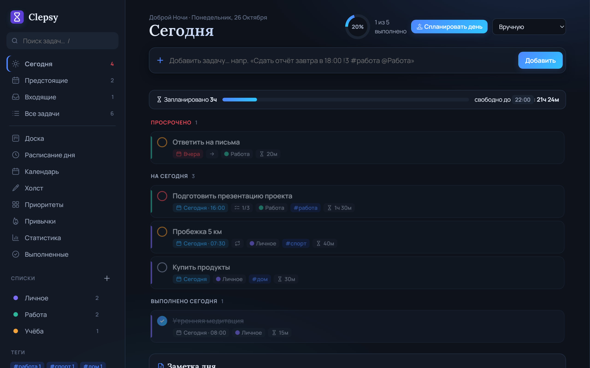
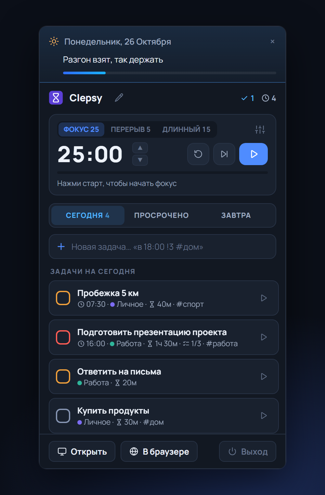
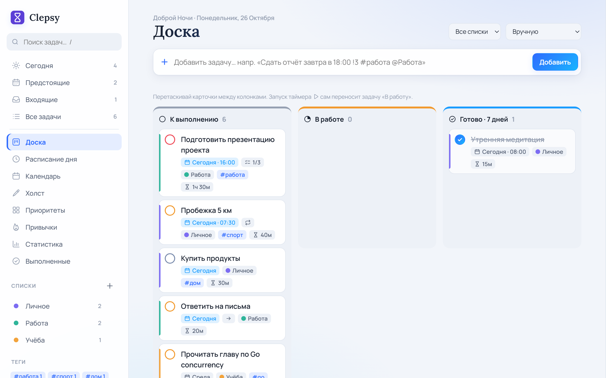

# ⏳ Clepsy

Личный планировщик задач: основное окно в браузере и мини-панель в трее Windows. Бэкенд на Go, фронтенд на чистом HTML/CSS/JS, всё встроено в один `Clepsy.exe`. Данные хранятся в `data.json` рядом с exe.

<p align="center">
  
  
</p>
<p align="center"></p>

## Скачать

Готовый exe для Windows 10/11 лежит в **[Releases](../../releases/latest)**. Скачай `Clepsy.exe`, положи в любую папку и запусти. Установка не нужна. Данные сохраняются в `data.json` рядом с exe.

> Windows SmartScreen может предупредить о неизвестном издателе, потому что exe не подписан. Нажми «Подробнее» → «Выполнить в любом случае».

## Запуск

Двойной клик по exe: в трее появится иконка ✓, а в браузере откроется http://127.0.0.1:8080.

- **«Открыть»** показывает окно программы. Оно всегда одно: повторное нажатие или двойной клик по ярлыку выводит его вперёд, а не плодит вкладки. Крестик прячет окно в трей. **«В браузере»** открывает ту же страницу в браузере.
- **Левый клик по иконке** открывает мини-панель над треем: задачи на сегодня, просроченные и на завтра, быстрое добавление, отметка выполнения, таймер. Клик мимо панели её прячет.
- **Правый клик** открывает меню: «Открыть Clepsy», «Запускать вместе с Windows», «Выход».
- Повторный запуск exe не создаёт вторую копию, а просто открывает браузер.

Флаги: `-addr`, `-data`, `-no-open`, `-no-tray` (только сервер), `-autostart` (тихий запуск), `-popup` (сразу показать панель).

## Сборка

Двойной клик по `build.bat` (или `.uild.ps1` в PowerShell). Скрипт по очереди:

1. проверяет форматирование Go и синтаксис JS;
2. запускает `go vet` и все тесты, включая **проверку страниц в браузере без окна**: Edge или Chrome открывает основную страницу и мини-панель, они сами обходят все разделы, а тест падает на любой ошибке JavaScript с указанием файла и строки;
3. только если всё прошло, собирает `Clepsy.exe`. Если программа запущена, скрипт останавливает её и запускает заново.

Иконка меняется отдельно:

```bash
go run ./tools/genicon
go run github.com/tc-hib/go-winres@v0.3.3 simply --arch amd64 --icon assets/icon.ico --manifest gui --product-name "Clepsy"
```

Фронтенд лежит в `web/`: `shared.js` общий для окна и мини-панели, `js/*.js` — модули основной страницы (core, quickadd, render, views, plan, detail, actions, pomodoro, ui, main), `popup.html` — мини-панель. Страницы встраиваются в exe, поэтому после правок нужна пересборка.

## Что умеет

- **Задачи**: приоритеты, дедлайн (дата + время), списки, теги, подзадачи с прогрессом, заметки, закрепление.
- **Повторяющиеся задачи**: каждый день / по будням / неделю / месяц / год — после выполнения создаётся следующая.
- **Быстрый ввод**: `Сдать отчёт завтра в 18:00 !3 #работа @Работа` — дата, время, приоритет, теги и список распознаются сами.
- **Разделы**: Сегодня (с кольцом прогресса и заметкой дня), Предстоящие на 7 дней, Входящие, Все задачи, Выполненные.
- **Календарь** на месяц — задачи можно перетаскивать между днями.
- **Приоритеты** (матрица Эйзенхауэра): задачи раскладываются по важности и срочности.
- **Настройки**: тема, запуск вместе с Windows, что делает крестик окна (свернуть в трей или закрыть программу), уведомления, конец рабочего дня, длительности Помодоро, папка с данными, экспорт и импорт.
- **Холст** для быстрых набросков (клавиша `D` или ✏️ в мини-панели): ручка с нажимом для пера, маркер, ластик, цвета, толщина, отмена, сохранение само через секунду и галерея набросков. Картинки лежат PNG-файлами в папке `sketches` рядом с `data.json`.
- **Трекер привычек** — отметки за неделю, серии 🔥, карта за 30 дней.
- **Помодоро-таймер** 25/5/15, общий для окна, мини-панели и трея: после фокуса сам запускается перерыв, а мини-панель всплывает со звуком. Оставшееся время видно в подсказке иконки.
- **Перенос невыполненного**: у задачи можно выбрать «переносится на сегодня» или «сдвигается весь план». Во втором случае все задачи плана (например, курса) заново раскладываются от сегодняшнего дня по сетке «сколько задач в какой день недели».
- **Статистика**: выполнено за день/неделю, серия дней, графики по спискам и приоритетам.
- Перетаскивание для ручной сортировки, сортировка по приоритету/сроку, поиск.
- Уведомления браузера о дедлайнах, светлая/тёмная тема, экспорт/импорт JSON, адаптивная вёрстка под телефон.

### Фишки из open-source проектов

- **Канбан-доска** «К выполнению / В работе / Готово», как в [Vikunja](https://vikunja.io/).
- **Оценка и учёт времени**: ▶ на задаче, «затрачено / оценка», полоса загрузки дня с предупреждением о перегрузе, как в [Super Productivity](https://super-productivity.com/).
- **Расписание дня** (тайм-блокинг): задачи перетаскиваются на шкалу времени, длина блока равна оценке.
- **Умная сортировка** по срочности, формула [Taskwarrior](https://taskwarrior.org/docs/urgency/): приоритет, близость дедлайна, возраст, «в работе», теги.
- **Ритуал «Спланировать день»** (клавиша `P`), как в Sunsama: разобрать просроченные, набрать задач, проверить загрузку.

## Горячие клавиши

`N` — новая задача, `/` — поиск, `1`–`9` — разделы, `P` — спланировать день, `T` — тема, `Esc` — закрыть панель, `?` — справка.

## API

| Метод | Путь | Что делает |
|---|---|---|
| GET | `/api/state` | всё состояние |
| GET / POST | `/api/tasks` | список / создать |
| PUT / DELETE | `/api/tasks/{id}` | изменить / удалить |
| POST | `/api/tasks/{id}/toggle` | отметить выполнение |
| POST | `/api/tasks/reorder` | новый порядок (массив id) |
| POST | `/api/tasks/clear-completed` | удалить выполненные |
| POST, PUT, DELETE | `/api/lists[/{id}]` | списки |
| POST, DELETE | `/api/habits[/{id}]` | привычки |
| POST | `/api/habits/{id}/toggle/{date}` | отметка привычки |
| GET / PUT | `/api/notes/{date}` | заметка дня |
| GET / POST | `/api/export`, `/api/import` | резервная копия |

## Благодарности

Часть линейных иконок интерфейса нарисована по мотивам набора [Lucide](https://lucide.dev) (лицензия ISC).
